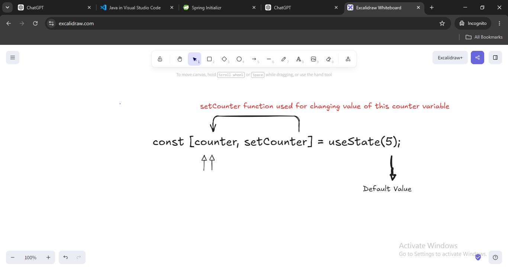

# bg-changer project (React with tailwind css)

## useState Hook 
> A state of a component is a variable that holds some information that may changes over the lifetime of the component. **Whenever the value of the state changes, the component re-renders itself with updated values.**
```javascript
 const [counter, setCounter] = useState(0);
 ```
 - The `useState()` hook returns a array of size 2, at the first index a variable with default value and at second index a function to change the value of that variable.
 - Let's understand this bit by bit again, 
 ```javascript
 const [counter, setCounter] = useState(5);
 ```
 here `counter` is a variable, `setCounter` is a function that will be used for changing the value of `counter` variable and in `useState(5)` the value 5 is the default value we set for the `counter` variable. 
 
